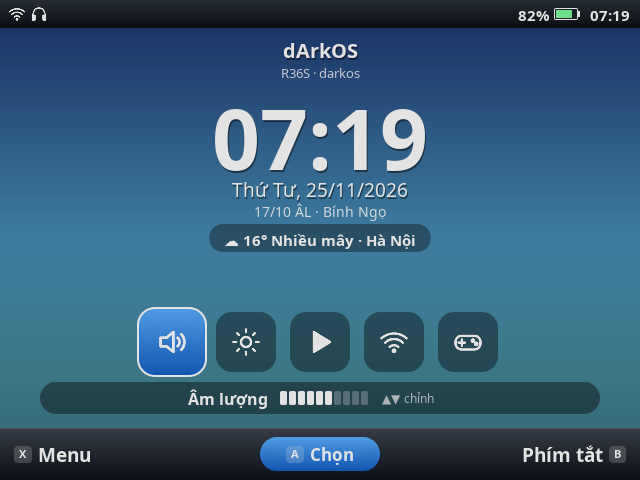
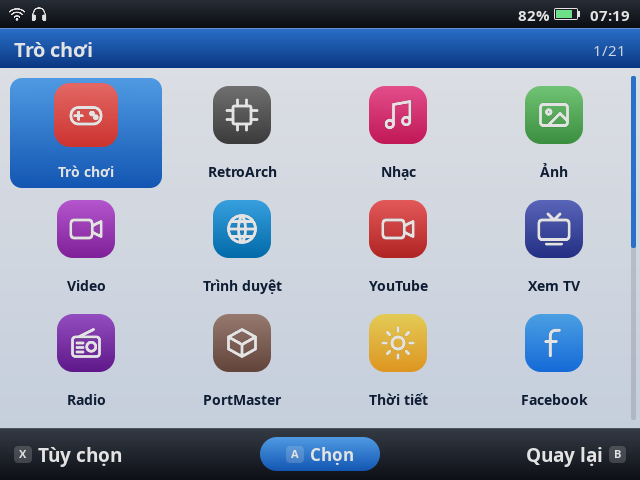
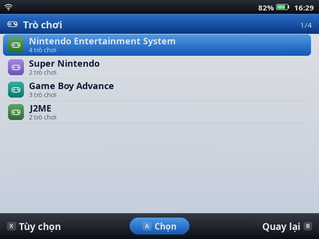
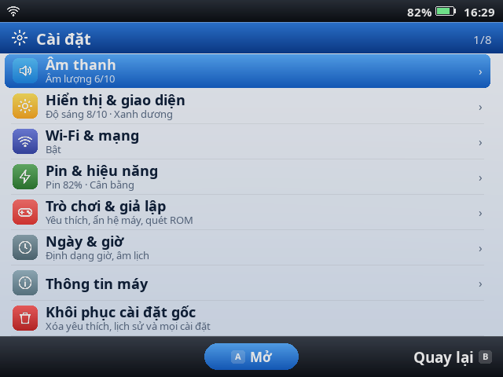
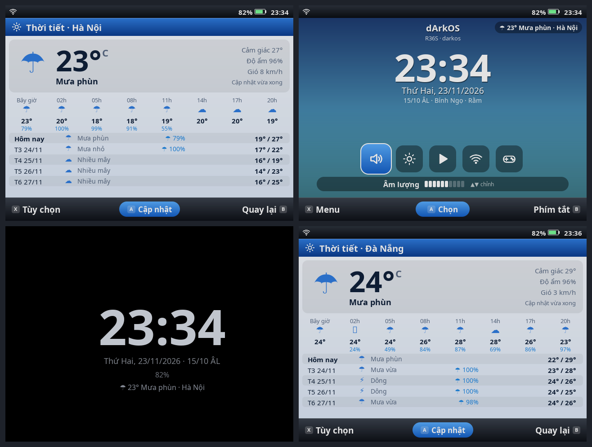
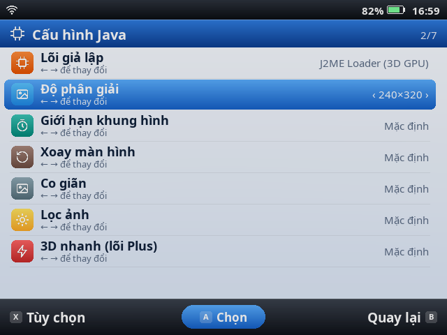

# dArkOS-R36S-S40

> **EN:** One-command installer of a Nokia S40 style launcher (online video via yt-dlp, TV, radio, weather, browser, file manager, Java/J2ME games) for **dArkOS on the R36S / RK3326 retro handheld**, with automatic RetroArch 32/64-bit and PPSSPP tuning that survives OS updates. Switch between the S40 launcher and EmulationStation at any time. **VI:** Bộ cài giao diện S40 cho máy chơi game cầm tay R36S chạy dArkOS.

Bộ cài **giao diện S40 (phong cách Nokia Series 40)** cho máy chơi game cầm tay **R36S** (RK3326, 1 GB RAM) đang chạy **dArkOS**. Một lệnh là xong: **không cần ghi lại thẻ nhớ, không mất game, không đụng vào dữ liệu**. EmulationStation vẫn còn nguyên và bạn **chuyển qua lại giữa hai giao diện chỉ bằng một mục menu**. Kèm theo là bộ **tối ưu tự động** cho RetroArch (cả 64 và 32 bit), PPSSPP và thư viện hệ thống, được áp dụng lại ở mỗi lần bật máy nên **cập nhật dArkOS không làm mất**.

> Repo này **không chứa dArkOS** (cần một thẻ dArkOS đang chạy được: [christianhaitian/dArkOS](https://github.com/christianhaitian/dArkOS)) và **không chứa ROM, BIOS hay game**.

| Màn hình chính | Menu | Trò chơi |
|---|---|---|
|  |  |  |

> Ảnh chụp từ bản chạy thử trên máy tính (cùng mã nguồn launcher), trên máy thật hiển thị giống hệt ở 640x480.

## English summary

**dArkOS-R36S-S40** adds a phone-style **custom launcher / frontend** to a stock **dArkOS** card on the **R36S** (and R36S clones, RK3326, 1 GB RAM), as an alternative to EmulationStation. It installs in one command, keeps your games and settings, and lets you switch back to EmulationStation with one menu entry.

- **Apps:** native **online video** player for YouTube links through yt-dlp + mpv (unofficial, see the legal notes; gamepad seek/pause), **IPTV** (iptv-org, ~38k channels by category / language / country), **internet radio** (225 countries), **weather**, **web browser** (WPE WebKit + ad block), **file manager with zip/rar/7z extraction**, **Java ME (J2ME) games**, video and photo viewers with **hidden items + optional password**, low-battery **voice warning** (vi / en / zh).
- **Emulators:** one-tap **RetroArch 64-bit and 32-bit** settings, per-game core and overrides, PPSSPP button fixes (FN opens the menu).
- **Auto-tuning (`s40-tune`):** RetroArch core options (frameskip, PS1 dynarec, interpolation), auto-save/load off, PPSSPP hotkeys, SDL2/libmali link repair; backed up, reversible, **re-applied at every boot so dArkOS OTA updates do not undo it**.
- **Install:** `curl -L https://github.com/phucph0501/dArkOS-R36S-S40/archive/refs/heads/main.tar.gz | tar xz && cd dArkOS-R36S-S40-main && sudo bash install.sh` (see [Cài đặt](#cài-đặt)). **Uninstall:** `sudo bash uninstall.sh`.
- **Not included:** ROMs, BIOS, commercial games. Free, non-commercial, MIT for the original code, third-party parts keep their licenses ([THIRD_PARTY_NOTICES.md](THIRD_PARTY_NOTICES.md)).

## Mục lục

[Bạn được gì](#bạn-được-gì) · [Tối ưu tự động](#tối-ưu-tự-động-và-bền-qua-cập-nhật) · [Ưu điểm và nhược điểm](#ưu-điểm-và-nhược-điểm) · [Cài đặt](#cài-đặt) · [Chuyển giao diện](#chuyển-qua-lại-giữa-các-giao-diện) · [Gỡ cài đặt](#gỡ-cài-đặt) · [Xử lý sự cố](#xử-lý-sự-cố) · [Nguồn và ghi công](#nguồn-tham-khảo-và-ghi-công) · [Giấy phép](#giấy-phép-và-lưu-ý-pháp-lý)

## Bạn được gì

- **Video trực tuyến** (xem video YouTube qua yt-dlp và mpv, **không chính thức**, xem mục lưu ý pháp lý): tìm kiếm, ảnh thu nhỏ, giới hạn độ phân giải cho chip yếu. Tay cầm: trái/phải tua 10 giây (giữ để tua nhanh 20, 30, 60 giây), lên/xuống chỉnh độ sáng video, A tạm dừng, B thoát.
- **Xem TV và Radio**: kênh TV từ [iptv-org](https://github.com/iptv-org/iptv) chia thành ba danh sách **Thể loại, Ngôn ngữ, Quốc gia** (khoảng 38.000 mục, nhóm nhỏ bên trong), đài radio của 225 quốc gia từ [radio-browser.info](https://www.radio-browser.info). Có ô tìm kiếm bằng bàn phím hệ thống.
- **Video và Ảnh** với tính năng **ẩn mục** (có mật khẩu tùy chọn, tương thích cờ `<hidden>` của EmulationStation), xem video bằng mpv điều khiển bằng tay cầm.
- **Thời tiết** (Open-Meteo), **âm lịch**, đồng hồ, nhắc việc, máy tính, lịch.
- **Trình duyệt** (WPE WebKit) có chặn quảng cáo, kèm hai **lối tắt tới trang web** `m.facebook.com` và `web.telegram.org` (chỉ mở trang web công khai, không phải ứng dụng chính thức của các dịch vụ đó).
- **Quản lý tệp** có sao chép/đổi tên/xóa, tệp ẩn, **giải nén zip/rar/7z (kể cả có mật khẩu)** và nén lại.
- **Game Java (J2ME)** bằng lõi J2ME Loader/FreeJ2ME-Plus: thêm hệ máy Java vào EmulationStation, cấu hình riêng từng game.
- **RetroArch và RetroArch 32** mở thẳng từ menu chính để tự chỉnh core, phím, shader. Cài đặt toàn cục, sao lưu và đặt lại áp dụng cho cả hai bản.
- **Cảnh báo pin yếu bằng giọng nói** (tiếng Việt / English / 中文 theo cài đặt ngôn ngữ) ở mức 20% và 10%. Dùng đúng số pin của dArkOS, **không thay** dịch vụ đo pin của bạn.
- **Ba ngôn ngữ**: Tiếng Việt, English, 中文, bàn phím nhập liệu trên màn hình, biểu tượng tai nghe/USB trên thanh trạng thái.

| Cài đặt | Thời tiết | Game Java |
|---|---|---|
|  |  |  |

## Tối ưu tự động và bền qua cập nhật

Bộ cài cài thêm dịch vụ `s40-tune` (kiểm tra bằng `s40-tune.sh status`). Nó áp dụng một **hồ sơ tối ưu** cho máy R36S và **chạy lại ở mỗi lần bật máy**, nên nếu một bản cập nhật dArkOS ghi đè các tệp cấu hình thì hồ sơ được áp dụng lại. Mỗi tệp được **sao lưu một lần** trước khi sửa, chỉ các khóa trong hồ sơ bị đụng tới, và có thể hoàn tác bằng `sudo s40-tune.sh revert`.

| Thành phần | Thay đổi | Lý do |
|---|---|---|
| RetroArch 64 và 32 bit | tắt tự lưu / tự tải trạng thái, tắt cổng điều khiển mạng | không còn thông báo "không có file save", đỡ ghi thẻ nhớ và đỡ tốn CPU |
| Tùy chọn lõi | `frameskip` tự động cho SNES, GBA, arcade (FBNeo), PS1; PS1 bật dynarec, tắt cải tiến NEON; âm thanh FM/mẫu dùng nội suy tuyến tính | giữ tốc độ đầy đủ trên RK3326 và đỡ rè tiếng |
| PPSSPP (phím) | nút **FN** mở menu PPSSPP; **L3/R3 không còn gán Lưu/Tải trạng thái** | bấm cần analog khi chơi làm game đơ rồi báo lỗi; FN rảnh |
| Thư viện hệ thống | tự sửa liên kết SDL2 (bản của dArkOS) và `libwayland-egl` nếu một gói làm hỏng | tránh ứng dụng SDL, mpv, trình duyệt không chạy sau cập nhật |

Chi tiết từng khóa nằm ở [docs/OPTIMIZATIONS.md](docs/OPTIMIZATIONS.md). Bộ cài **chỉ chỉnh những gì đã được kiểm chứng** trên máy thật; các thiết lập khác (DraStic, mupen64plus, hiệu năng CPU…) giữ nguyên của dArkOS.

## Ưu điểm và nhược điểm

### Ưu điểm so với dùng EmulationStation thuần

| Hạng mục | EmulationStation (dArkOS) | S40 sau khi cài |
|---|---|---|
| Giao diện | chủ yếu để chọn game | menu lưới kiểu điện thoại, phím mềm, nhiều tiện ích ngoài game |
| Video online | không có | xem video YouTube qua yt-dlp (không chính thức), điều khiển bằng tay cầm |
| Xem TV / Radio | không có | hàng chục nghìn kênh TV, đài radio theo nước, tìm kiếm |
| Trình duyệt web | không có | có, chặn quảng cáo, kèm lối tắt tới vài trang web phổ biến |
| Game Java (J2ME) | phải tự cài | có sẵn, tự thêm hệ máy |
| Quản lý tệp, giải nén | công cụ rời | có sẵn, giải nén zip/rar/7z |
| Ẩn video/ảnh | chỉnh `gamelist.xml` bằng tay | menu, có mật khẩu, tương thích cờ của ES |
| Tối ưu RetroArch/PPSSPP | tự chỉnh bằng tay | tự động, bền qua cập nhật, có sao lưu và hoàn tác |
| Chuyển giao diện | không áp dụng | một mục menu, hai chiều, nhớ lựa chọn |
| Cài đặt | phải ghi lại thẻ | một lệnh, giữ nguyên game và cài đặt |

### Nhược điểm và đánh đổi

- **Tốn RAM hơn một chút** (launcher, trình duyệt và YouTube dùng thêm bộ nhớ) trên máy chỉ có 1 GB. Mở trình duyệt hoặc xem video nặng cùng lúc có thể chậm.
- **Cần mạng khi cài** (khoảng 100 MB gói và công cụ). Mạng yếu thì dùng `--debs` với gói chép sẵn.
- **Cổng OTG dùng chung đường USB với Wi‑Fi** trên nhiều máy R36S (Wi‑Fi hàn trên main): cắm tai nghe hoặc USB vào OTG có thể làm mất Wi‑Fi. Dùng jack 3.5 mm.
- **Số pin là số của dArkOS** (cảm biến của nhân) và có thể lệch thực tế; bộ cài cố ý không thay dịch vụ đo pin của bạn.
- **YouTube phụ thuộc yt-dlp và mạng**: YouTube đổi cách phát thì phải cập nhật yt-dlp (có nút trong ứng dụng). Chip RK3326 nên xem 360p–480p.
- **Ẩn mục chỉ giấu khỏi danh sách** của S40 (và cờ của ES), **không mã hóa**: ai mở bằng Quản lý tệp hoặc cắm thẻ vào máy tính vẫn thấy tệp.
- **Hồ sơ tối ưu có chọn lựa mặc định**: tắt tự lưu/tải trạng thái. Ai thích "tiếp tục ngay" của dArkOS cần sửa hồ sơ `profile.json` (hoặc chạy `s40-tune.sh revert`).
- **Không tự cập nhật S40**: muốn bản mới thì tải lại repo và chạy lại `install.sh`.
- Chưa thử trên mọi đời R36S/clone; một số tính năng cần Wi‑Fi (YouTube, thời tiết, TV, Radio).

## Cài đặt

**Yêu cầu:** máy R36S/RK3326 chạy **dArkOS** (Debian 13, aarch64), còn trống ít nhất **900 MB** trên phân vùng hệ thống, có Wi‑Fi, SSH đã bật (Options → Tools → *Enable Remote Services*; hoặc dùng Terminal trên máy).

**Cách 1: tải thẳng trên máy** (có `curl`, mặc định có trên dArkOS):

```bash
cd ~
curl -L https://github.com/phucph0501/dArkOS-R36S-S40/archive/refs/heads/main.tar.gz | tar xz
cd dArkOS-R36S-S40-main
sudo bash install.sh
```

**Cách 2: tải về máy tính rồi chép qua SSH** (Wi‑Fi của máy chậm hoặc không có mạng):

```powershell
scp -r dArkOS-R36S-S40 ark@IP-CỦA-MÁY:/home/ark/
ssh ark@IP-CỦA-MÁY "cd ~/dArkOS-R36S-S40 && sudo bash install.sh"
```

Bộ cài tự: cài thư viện cần thiết qua `apt`, giải nén chương trình (`dist/s40-bin-aarch64.tgz`), tải yt-dlp / Node.js / 7-Zip từ trang chính thức, thêm hệ máy **Java** vào EmulationStation, **áp dụng hồ sơ tối ưu**, bật cảnh báo pin yếu, rồi đặt S40 làm giao diện mặc định (EmulationStation vẫn còn). Mất vài phút đến vài chục phút tùy tốc độ mạng.

| Tùy chọn | Ý nghĩa |
|---|---|
| `--default es` | cài nhưng vẫn mặc định EmulationStation |
| `--no-default` | cài nhưng không đổi giao diện |
| `--debs THƯ_MỤC` | dùng gói `.deb` chép sẵn thay vì tải (mạng yếu) |
| `--bin tệp-hoặc-URL` | dùng tệp chương trình khác |
| `--yes` | không hỏi lại |

## Chuyển qua lại giữa các giao diện

- Trong **S40**: menu **Nguồn → Đặt EmulationStation làm giao diện mặc định** (hoặc *Mở EmulationStation một lần*: thoát ES thì quay lại S40).
- Trong **EmulationStation**: **Tools → Switch to S40 Launcher**.
- Từ terminal: `sudo switch-launcher.sh s40` hoặc `sudo switch-launcher.sh es`.

Lựa chọn được nhớ cho các lần bật máy sau. Việc chuyển tự diệt các tiến trình sót của giao diện cũ và kiểm tra giao diện mới đã chạy.

## Gỡ cài đặt

```bash
sudo bash uninstall.sh
```

Trả các tệp cấu hình đã tối ưu về bản gốc, đưa máy về EmulationStation và xóa S40. Game, cài đặt dArkOS và EmulationStation không bị đụng tới (các gói hệ thống như mpv, WebKit được giữ lại).

## Xử lý sự cố

| Triệu chứng | Cách xử lý |
|---|---|
| Màn hình không hiện S40 sau khi chuyển | `sudo switch-launcher.sh s40`; xem `journalctl -u s40` |
| Muốn về EmulationStation ngay | `sudo switch-launcher.sh es` |
| Cài đặt dở dang / mạng ngắt | chạy lại `sudo bash install.sh`, bộ cài chạy lại được nhiều lần |
| Kiểm tra tối ưu | `sudo s40-tune.sh status` (0 tệp lệch hồ sơ là đúng) |
| Hoàn tác tối ưu | `sudo s40-tune.sh revert` |
| YouTube không phát | trong YouTube chọn cập nhật yt-dlp; kiểm tra Wi‑Fi |
| Trình duyệt trang trắng | đảm bảo đã cài đủ thư viện (chạy lại `install.sh`) |

## Tự biên dịch

Mã nguồn trong `src/` (`s40launcher`, `s40web`, `common`). Biên dịch trên máy aarch64 (hoặc bằng qemu): cần `g++`, `make`, `libsdl2-dev`, `libsdl2-ttf-dev`, `libsdl2-image-dev`, `libsdl2-mixer-dev`, `libvterm-dev`; trình duyệt cần thêm `libwpewebkit-2.0-dev`, `libwpebackend-fdo-1.0-dev`. `make-bin-kit.sh` đóng gói tệp chương trình thành `dist/s40-bin-aarch64.tgz`.

## Nguồn tham khảo và ghi công

Nền hệ thống là **dArkOS**; trình phát **mpv**; YouTube qua **yt-dlp** và **Node.js**; trình duyệt **WPE WebKit**; Java dùng **FreeJ2ME-Plus** và **J2ME Loader**; giải nén **7-Zip**; kênh TV từ **iptv-org**; đài radio từ **radio-browser.info**; thời tiết **Open-Meteo**. Toàn bộ nguồn, giấy phép và liên kết nằm ở [THIRD_PARTY_NOTICES.md](THIRD_PARTY_NOTICES.md). Giao diện chỉ *lấy cảm hứng* từ điện thoại Nokia Series 40, không dùng tài sản của Nokia.

## Giấy phép và lưu ý pháp lý

- Mã tự viết theo giấy phép **MIT** ([LICENSE](LICENSE)). Các thành phần bên thứ ba giữ giấy phép riêng.
- **Không kèm ROM, BIOS hay game thương mại.** Bạn tự chép game bạn sở hữu hợp pháp.
- Tính năng **Video trực tuyến** là **không chính thức**, không liên kết với YouTube/Google và có thể ngừng hoạt động bất cứ lúc nào khi YouTube thay đổi; bộ cài không chứa mã của yt-dlp mà tải từ trang chính thức của yt-dlp.
- Danh sách TV chỉ là liên kết tới luồng công khai; nội dung thuộc về các đài. Tải nội dung YouTube có thể trái điều khoản của YouTube ở nước bạn, hãy tự chịu trách nhiệm.
- Tên và logo YouTube, Facebook, Telegram, Nintendo, Sony, Sega, Nokia thuộc chủ sở hữu tương ứng; dự án không liên kết với các bên đó.
- Dự án **miễn phí, phi thương mại**: không bán máy hay thẻ cài sẵn.

## Từ khóa / Keywords

R36S, R36S launcher, R36S custom firmware, R36S giao diện, RK3326, dArkOS, ArkOS, EmulationStation alternative, frontend, launcher, Nokia S40, Nokia theme, retro handheld, máy chơi game cầm tay, RetroArch 32 bit, RetroArch 64 bit, PPSSPP, J2ME, Java ME games, game Java, FreeJ2ME, J2ME Loader, YouTube trên máy chơi game, YouTube handheld, IPTV, xem TV, radio, thời tiết, âm lịch, trình duyệt, quản lý tệp, giải nén, tối ưu giả lập, Vietnam, tiếng Việt, Linux handheld, Debian, aarch64, Rockchip.
